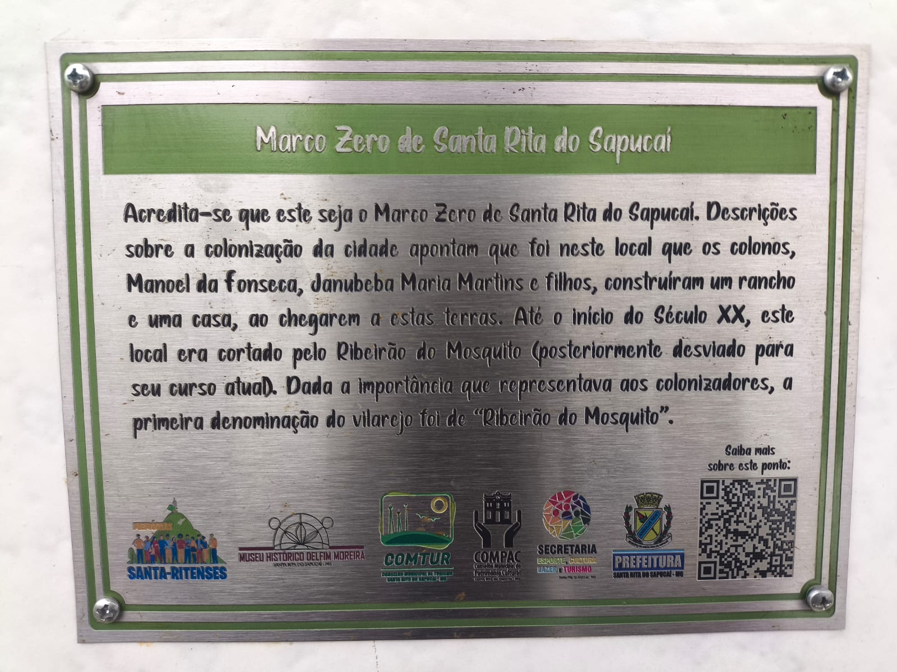
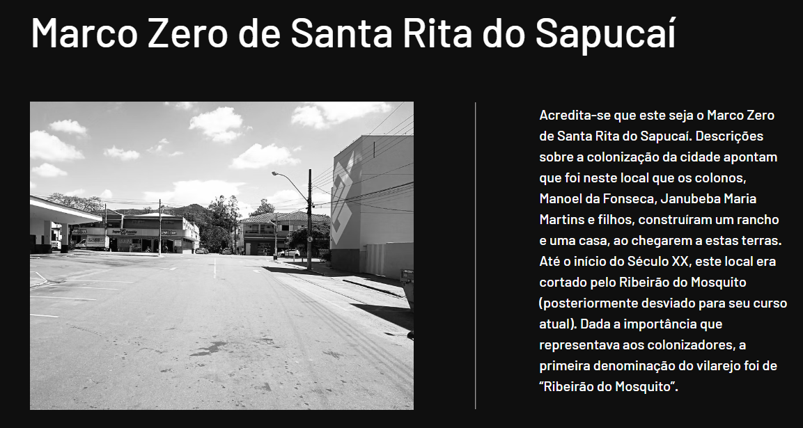

# Relatório CTF

**Nome:** Hiago

---

## Desafio: 404: Origem Perdida

### Analisando o Desafio

O desafio apresenta um texto sobre a origem de uma cidade, mencionando uma pequena placa de metal que marcaria o local onde teria surgido o antigo vilarejo de Ribeirão do Mosquito, que posteriormente se desenvolveu e se tornou um importante polo eletrônico do país.

A partir das informações fornecidas, o objetivo era descobrir a localização dessa placa e, consequentemente, identificar a resposta esperada pelo desafio.

Foram fornecidos um texto e uma imagem de uma placa.

### Analisando a Imagem

Ao analisar a imagem, foi identificado um QR Code que, ao ser lido, redirecionava para um site. Porém, o site estava fora do ar.



### Recuperando o Site

Como o site original estava fora do ar, foi utilizada a **Wayback Machine**, serviço que permite consultar versões arquivadas de páginas da internet.

Foi encontrada uma versão arquivada do site referente ao dia **26 de março de 2025**, período em que a página ainda estava disponível.

Nessa versão antiga do site havia uma segunda imagem, que mostrava uma rua contendo a placa mencionada na descrição do desafio.



### Localizando a Placa

A partir da imagem encontrada no arquivo do site, foi utilizado o **Google Maps** e o **Street View** para localizar o local apresentado.

Analisando a rua, os estabelecimentos e os elementos presentes na imagem, foi possível identificar a placa em frente a um estabelecimento chamado **Casa Miranda**.

Dessa forma, foi possível determinar a resposta solicitada pelo desafio.

### Flag

A flag encontrada foi:

```text
FLAG{CASA_MIRANDA}
```
