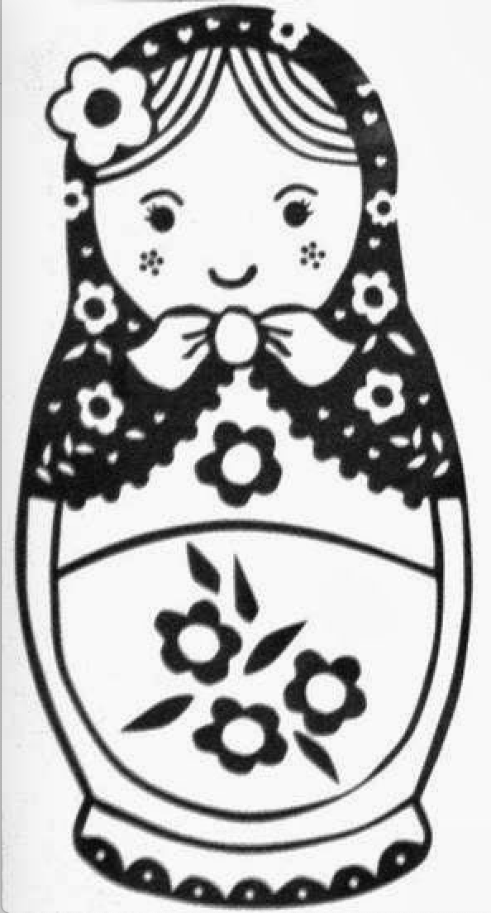
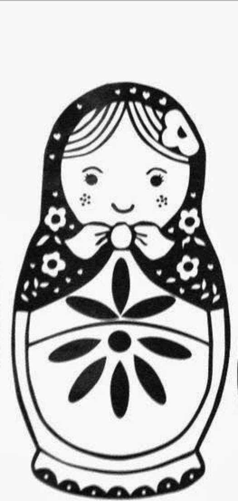
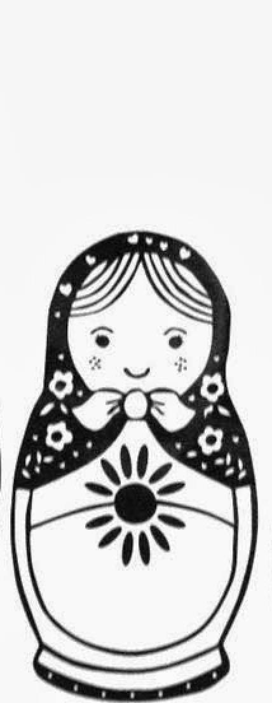
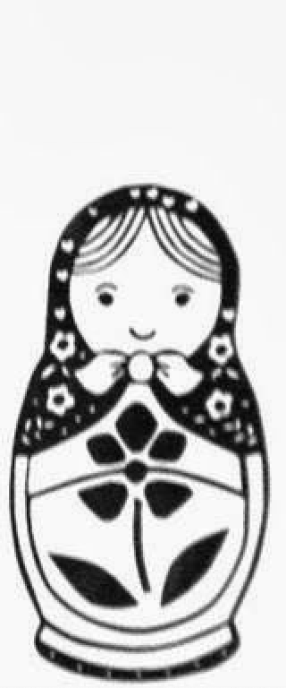

# Relatório CTF

**Nome:** Hiago

---

## Desafio: Matryoshka Doll

### Análise do Desafio

O desafio forneceu uma imagem de uma matriosca. Como o nome sugere, a solução
estava em camadas: havia arquivos compactados escondidos dentro da imagem e,
depois, outras imagens com novas camadas de arquivos.



### Analisando a Imagem

Enviei a imagem para o **Aperi'Solve**. Entre os resultados da análise, a
ferramenta identificou um arquivo ZIP embutido a partir do offset decimal
`272492` (`0x4286C`). O arquivo encontrado dentro do ZIP tinha o nome
`base_images/2_c.jpg`.

```text
DECIMAL       HEXADECIMAL     DESCRIPTION
272492        0x4286C         Zip archive data
                              name: base_images/2_c.jpg
```

### Extraindo as Camadas

Como a análise indicou que havia um ZIP dentro do arquivo, alterei a extensão
da cópia para `.zip` e extraí seu conteúdo. A primeira camada revelou outra
imagem:



Repeti o mesmo processo com as imagens encontradas. Cada extração revelou uma
nova pasta `base_images` e outra imagem, formando uma estrutura de camadas:

```text
dolls.jpg
├── 1ª extração: base_images/2_c.jpg
├── 2ª extração: base_images/base_images/3_c.jpg
└── 3ª extração:
    └── base_images/base_images/base_images/
        ├── 4_c.jpg
        └── flag.txt
```





Continuei extraindo os arquivos até chegar à última pasta, onde estava
`flag.txt`.

### Flag

```text
academy{ZNTyvSDXRNO1d0xCkBRMhAoiafpCTvgW}
```