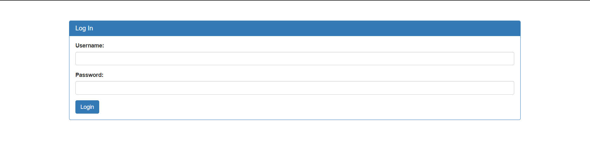
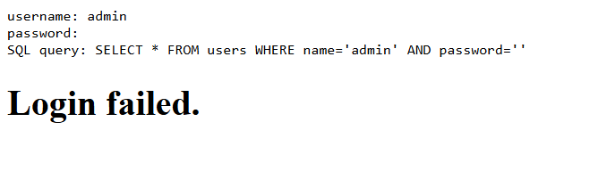
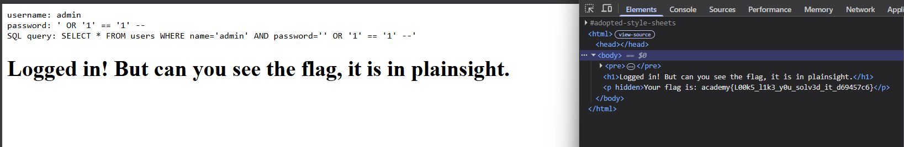

# Relatório CTF

**Nome:** Hiago

---

## Desafio: SQLiLite

### Análise do Desafio

O desafio apresentou uma página de login e pediu para acessar a conta
`admin`. A tela tinha campos para nome de usuário e senha. O tipo de falha
explorado foi **SQL injection (SQLi)**: uma entrada foi interpretada como parte
da consulta SQL usada para validar o login, em vez de ser tratada apenas como
texto.



### Testando o Login

Primeiro tentei entrar com uma senha qualquer. O login foi recusado, como
mostra a mensagem de erro e a consulta SQL exibida pela página. Isso serviu
como referência para entender como o valor dos campos aparecia na consulta.



### Explorando o Login

Mantive `admin` como nome de usuário e coloquei o seguinte texto no campo de
senha:

```text
' OR '1' == '1' --
```

A aplicação aceitou a entrada e exibiu a mensagem de login bem-sucedido.
Na imagem, a própria página mostra a consulta resultante:

```sql
SELECT * FROM users
WHERE name='admin' AND password='' OR '1' == '1' --'
```

O apóstrofo inicial encerra a string da senha que a consulta estava montando.
Em seguida, `OR '1' == '1'` acrescenta uma condição que é sempre verdadeira.
Como `AND` é avaliado antes de `OR`, a condição passa a ser equivalente a:

```text
(name='admin' AND password='') OR verdadeiro
```

Assim, o resultado da condição não depende da senha correta. O trecho `--`
inicia um comentário SQL e, neste desafio, faz com que o restante da consulta
gerada seja ignorado. A aplicação montava a consulta diretamente com os dados
inseridos, sem tratá-los como parâmetros separados, permitindo que a entrada
alterasse sua lógica.



### Encontrando a Flag

A página informou que a flag estava à vista, mas ela não aparecia no conteúdo
visível. Abri **Inspecionar** no navegador e procurei na aba **Elements**.
Encontrei a flag dentro de um parágrafo HTML marcado como oculto (`hidden`).
Esse atributo escondia o texto na página, mas não removia o conteúdo do HTML
carregado no navegador.

### Flag

```text
academy{l00k5_l1k3_y0u_s0lv3d_it_d69457c6}
```
