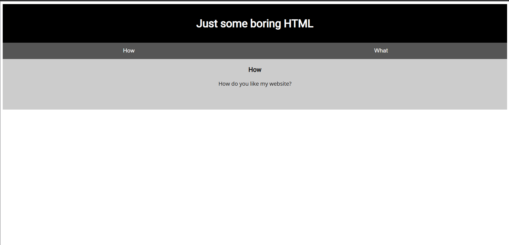

# Relatório CTF

**Nome:** Hiago

---

## Desafio: Scavenger Hunt

### Análise do Desafio

O desafio forneceu uma imagem de uma página simples e um endereço de site
para investigar. O objetivo era encontrar cinco partes da flag escondidas em
locais diferentes do site e juntá-las na ordem.



### Parte 1 — Comentário no HTML

Comecei inspecionando o código-fonte HTML da página. No final do conteúdo,
encontrei um comentário com a primeira parte:

```html
<!-- Here's the first part of the flag: academy{t -->
```

### Parte 2 — Comentário no CSS

Depois examinei o arquivo CSS referenciado pela página. Um comentário no fim
do arquivo continha a segunda parte:

```css
/* CSS makes the page look nice, and yes, it also has part of the flag.
   Here's part 2: h4ts_4_l0 */
```

### Parte 3 — `robots.txt`

No arquivo JavaScript havia uma dica:

```javascript
/* How can I keep Google from indexing my website? */
```

Essa pergunta apontava para o arquivo `robots.txt`, usado para indicar a
crawlers quais caminhos do site devem ou não ser indexados. Acessando
`http://site/robots.txt` — substituindo `site` pelo endereço fornecido no
desafio — encontrei a terceira parte e uma nova pista:

```text
User-agent: *
Disallow: /index.html
# Part 3: t_0f_pl4c
# I think this is an apache server... can you Access the next flag?
```

### Parte 4 — `.htaccess`

A referência ao Apache e à palavra “Access” indicava o arquivo de configuração
`.htaccess`, usado por servidores Apache. Seguindo essa pista no site,
encontrei a quarta parte e outra dica:

```text
# Part 4: 3s_2_lO0k
# I love making websites on my Mac, I can Store a lot of information there.
```

### Parte 5 — `.DS_Store`

A menção a um Mac e a “Store” apontava para `.DS_Store`, um arquivo que o
macOS cria para armazenar metadados de pastas. Ao verificar essa pista no site,
encontrei a última parte:

```text
Congrats! You've completed the scavenger hunt! Part 5: _2b9c61f}
```

### Montagem da Flag

Juntando as cinco partes na ordem em que foram encontradas — sem os sinais de
`+`, usados apenas para separar visualmente os fragmentos — obtive:

```text
academy{t + h4ts_4_l0 + t_0f_pl4c + 3s_2_lO0k + _2b9c61f}
```

### Flag

```text
academy{th4ts_4_l0t_0f_pl4c3s_2_lO0k_2b9c61f}
```